# Specimen: Application Flow (APP_FLOW)

| | |
|---|---|
| **Status** | Draft v0.1 |
| **Date** | 2026-11-25 |
| **Purpose** | Describe how users and the system move through Specimen: first run, capture, interpretation, browsing, MCP, export, and failure paths |
| **Related** | [PRD.md](PRD.md) · [SPEC.md](SPEC.md) · [TRD.md](TRD.md) · [AGENT.md](AGENT.md) · [TESTING_GUIDE.md](TESTING_GUIDE.md) · [IMPLEMENTATION-PLAN.md](IMPLEMENTATION-PLAN.md) |

Diagrams use Mermaid.

---

## 1. Map of all flows

| # | Flow | Actor | Entry point |
|---|---|---|---|
| 1 | First run and setup | Developer | `specimen init`, `specimen doctor` |
| 2 | Page capture | Developer | `specimen capture <url>` |
| 3 | Flow capture (scripted or recorded) | Developer | `specimen record`, `specimen capture --mode flow` |
| 4 | Crawl capture | Developer | `specimen capture --mode crawl` |
| 5 | Interpret stage (AI) | System, agent | automatic or `specimen interpret` |
| 6 | Normalize and de-duplicate | System | automatic or `specimen normalize` |
| 7 | Search and inspect | Developer | `specimen search`, `list`, `show` |
| 8 | Browse in the web app | Developer | `specimen serve` |
| 9 | Agent queries via MCP | AI agent | `specimen mcp` |
| 10 | Export tokens | Developer | `specimen export` |
| 11 | Share the library with a team | Developer | git |
| 12 | Failure and recovery paths | All | various |
| 13 | APK capture (v2) | Developer | `specimen capture app.apk` |

## 2. Flow 1: First run and setup

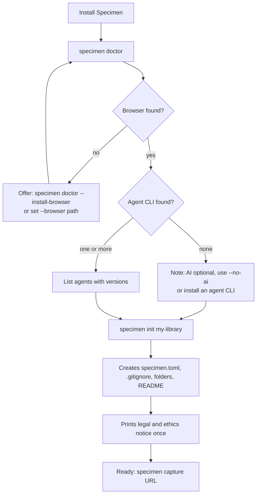

Behaviour notes:

- `doctor` is non-destructive and exits 0 even when optional parts are missing. It exits non-zero only when no usable browser exists.
- `init` is idempotent. Running it in an existing library reports "already initialised" and changes nothing.
- On first run, the notice states: respect site terms, the user is responsible for reuse, and Specimen is not legal advice. The notice is printed once and recorded in `specimen.toml` (`notice_acknowledged = true`).

## 3. Flow 2: Page capture (the core loop)

### 3.1 Sequence

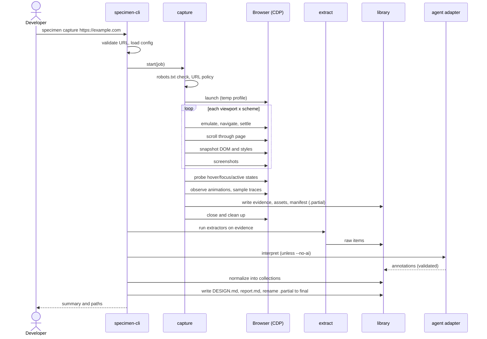

### 3.2 Capture job state machine

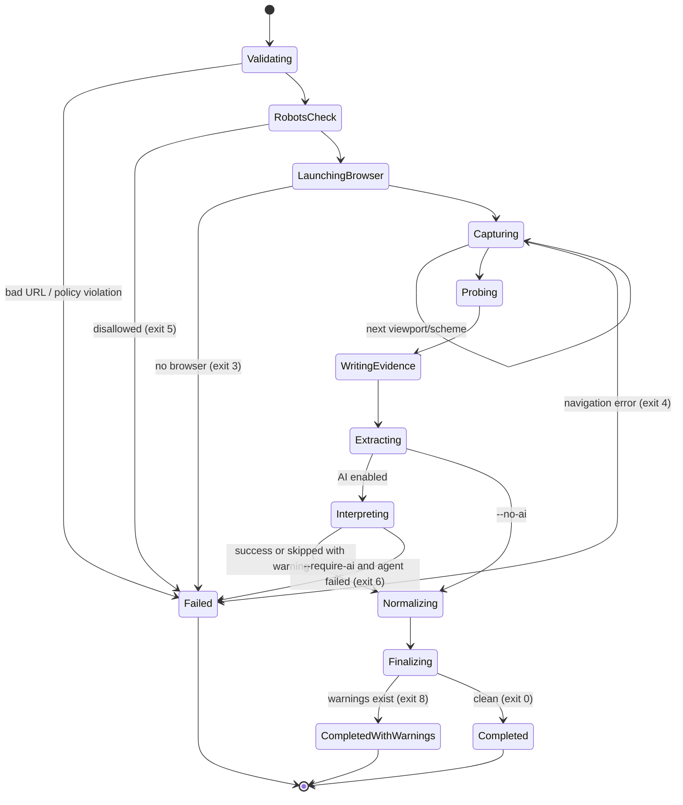

### 3.3 What the user sees (example terminal output)

```
$ specimen capture https://example.com
 ✓ Policy         robots.txt allows, rate limit 1 rps
 ✓ Browser        Chrome 1xx (headless)
 ✓ Capture        4 viewports × 2 schemes, 11 screenshots
 ✓ Assets         9 fonts files, 42 images, 31 svg (6 restricted)
 ✓ Extract        palette 2 · typography 1 · icons 31 · effects 14 · layouts 6 · animations 9 · components 18
 ✓ Interpret      claude-code (annotated 80 items)
 ✓ Normalize      61 new items, 12 merged into existing, 4 similar links
 ! Warnings       2 (see report.md)

 Source:  sources/example.com/2026-11-25T101500Z
 Design:  sources/example.com/2026-11-25T101500Z/DESIGN.md
```

Progress is shown with a spinner and a stage list on TTY; on non-TTY or `--json`, progress is emitted as newline-delimited JSON events.

## 4. Flow 3: Flow capture (scripted and recorded)

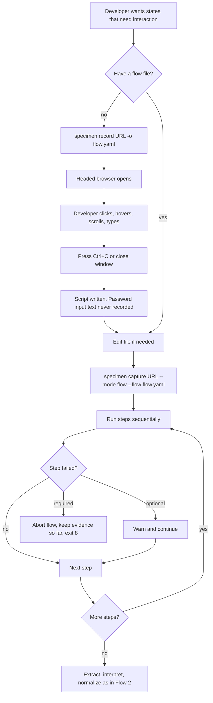

Behaviour notes:

- `capture:` steps inside the flow create additional evidence snapshots labelled with the step label, so a "menu open" state can yield its own components, layouts and screenshots.
- `eval:` steps are rejected unless `--allow-eval` is passed. The CLI prints the script before running.

## 5. Flow 4: Crawl capture

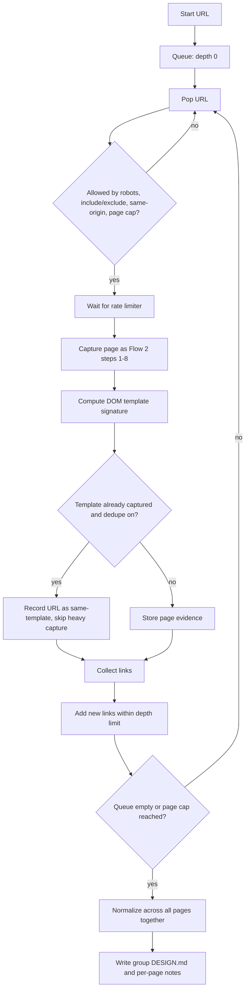

User controls: `Ctrl+C` stops gracefully, finalising whatever has been captured and marking the source `partial: true` in the manifest.

## 6. Flow 5: Interpret stage (AI annotation)

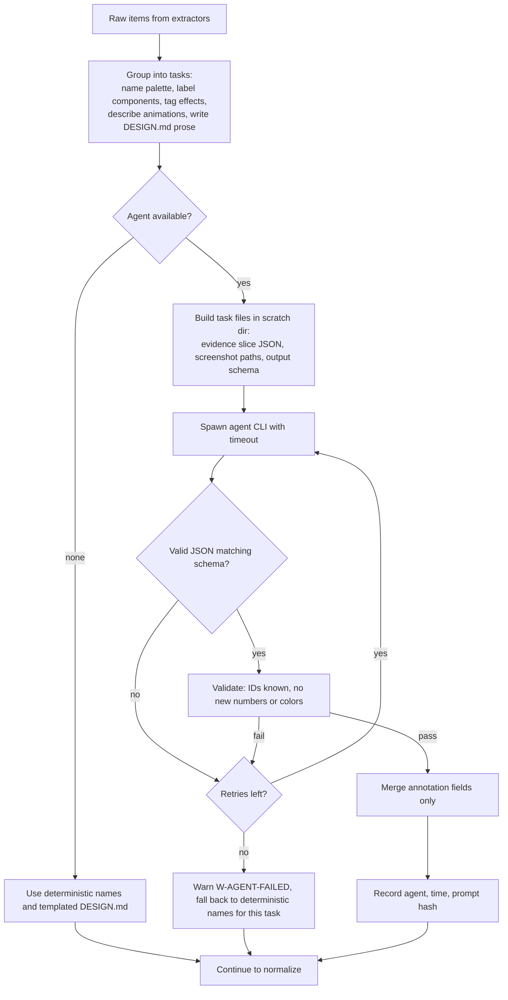

See AGENT.md Part B for prompts, schemas and guardrails.

## 7. Flow 6: Normalize and de-duplicate

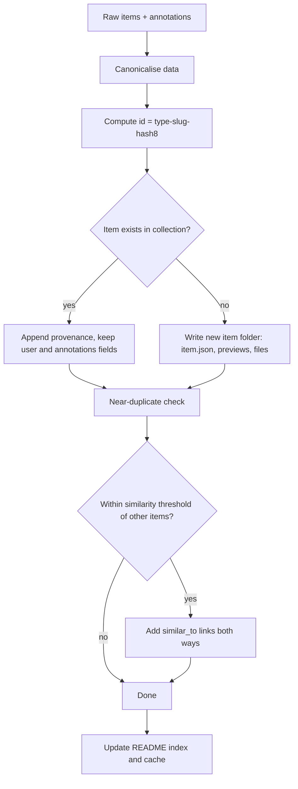

## 8. Flow 7: Search and inspect from the CLI

```
specimen search "glass card"
specimen search "type:palette near:#3b82f6 delta:0.05 scheme:dark license:reusable"
specimen list animations --trigger hover --duration "<400ms"
specimen show effect-frosted-glass-card-9f3a1c2e
```

- `search` prints a ranked table (ID, type, name, source, license, confidence).
- `show` prints the item's key data, a CSS snippet where relevant, provenance and the path to the preview image. With `--open` it opens the preview in the default viewer.
- `--json` returns structured output for scripting.
- No match prints a hint listing available types and tags, and exits 0.

## 9. Flow 8: Browse in the web app

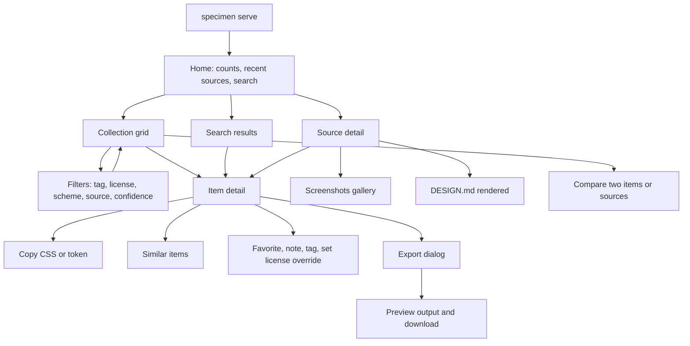

Page-specific behaviour:

| Page | Key interactions |
|---|---|
| Palette | Click swatch to copy value; "find near this color" runs a proximity search; contrast matrix toggles light and dark |
| Typography | Type specimen renders with the actual font file; toggle weights; scale table with copy |
| Animation | Loops the preview clip; timing curve drawn from easing; trigger and targets listed; speed control |
| Layout | Wireframe with breakpoint switcher; hover a block to see its flex or grid rules |
| Icons | Grid with size slider and color preview (for `currentColor` icons); license badge; copy SVG |
| Effects | Live-rendered sample using the CSS; toggle light and dark background |
| Component | State tabs (default, hover, focus, active, disabled) with screenshot and styles |

Write actions (favorite, notes, tags, license override) save into the item's `user` object. The UI shows a confirmation and the file changed, so the user understands the change appears in git diffs.

## 10. Flow 9: Agent queries via MCP

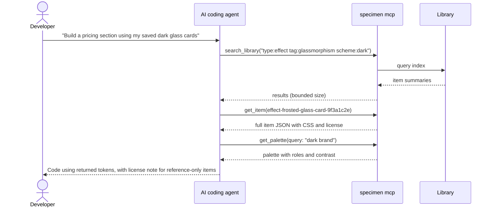

Behaviour notes:

- The MCP server is read-only by default and never returns paths outside the library.
- Items with `reference-only` or `unknown` license include a `license_warning` field so the agent can mention it to the user.
- `capture_url` is absent from the tool list unless enabled in config.

## 11. Flow 10: Export tokens

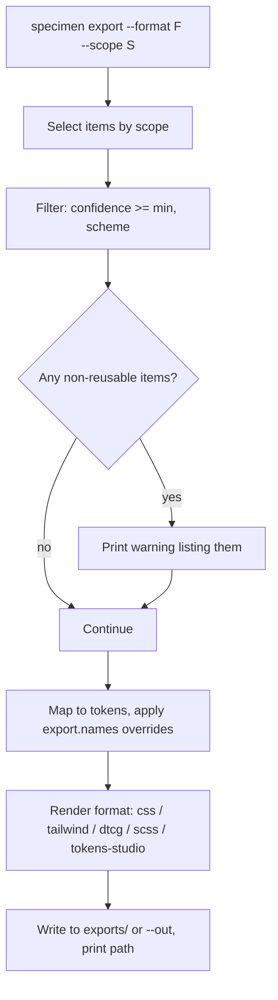

Example:

```
specimen export --format tailwind --tailwind-version 4 --scope source:example.com/2026-11-25T101500Z --scheme both
specimen export --format dtcg --scope items:palette-brand-dark-3b1c9a02,theme-dark-77ac10e4
```

## 12. Flow 11: Share the library with a team

1. The library is a git repository (`git init` inside the library folder).
2. The generated `.gitignore` excludes `.cache/` and `assets-restricted/`, so proprietary files stay local.
3. Teammates clone and run `specimen validate` to confirm schema health, then `specimen serve` or `specimen mcp`.
4. Merge conflicts are rare because items are separate files with content-hash IDs; `specimen normalize` can rebuild collections from sources if needed.
5. For large binaries (video, big fonts), enable Git LFS patterns in `.gitattributes` (documented, not automatic).

## 13. Flow 12: Failure and recovery paths

| Situation | Detection | User sees | Recovery |
|---|---|---|---|
| No browser | Discovery fails | Exit 3 with install hints | `specimen doctor --install-browser` or `--browser <path>` |
| Disallowed by robots.txt | Policy check | Exit 5, rule shown | Respect it, or run `--robots ignore` knowingly (prints warning) |
| Navigation timeout or HTTP error | CDP events | Exit 4 with status and last URL | Retry with larger `--timeout`, check connectivity |
| Bot protection or interstitial | Status codes and interstitial markers | `E-BLOCKED` with explanation | Try `--headed` and complete the check manually if the site allows; no evasion is attempted |
| Page needs login | Redirect to login detected | Hint about `--headed` | Sign in manually in the headed browser |
| Cross-origin iframes | Frame attach limits | `W-IFRAME` warning | Capture the iframe URL separately |
| Canvas or WebGL content | Detection | `W-CANVAS`, clip recorded | None; documented limitation |
| Agent not installed or not authenticated | `detect()` | `W-AGENT-SKIPPED`, deterministic output | Install or log in to an agent, then `specimen interpret <source>` |
| Agent output invalid | Schema and value validation | `W-AGENT-FAILED` for that task | Automatic retry, then fallback; re-run `interpret` later |
| Interrupted capture (Ctrl+C, crash) | `.partial` folder | Message with resume hint | Folder is not promoted; rerun capture, or `specimen sources rm` the partial |
| Disk full or permission denied | I/O error | Clear error and path | Free space, fix permissions; partial writes are atomic so the library stays valid |
| Library schema older than binary | Version check | Prompt to migrate | `specimen migrate` (backup made first) |
| Validation errors in library | `specimen validate` | List of files and problems | Fix manually or re-run normalize |

## 14. Flow 13: APK capture (v2 outline)

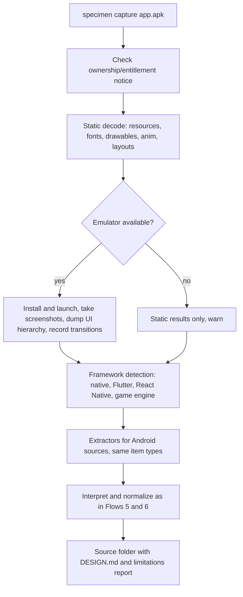

## 15. Cross-cutting UX rules

1. **Never surprise the user with network access.** Capture states which host it will contact before starting (`--dry-run` shows the full plan).
2. **Always show what was not captured.** Every run ends with a count of warnings and the path to `report.md`.
3. **Every item answers three questions:** where did this come from, may I reuse it, and how sure are you?
4. **Everything is a file.** If a user can see it in the UI, they can find it on disk.
5. **AI is optional and visible.** Output always says whether AI annotated it, and by which agent.
6. **Safe defaults, explicit overrides.** Risky options (`--robots ignore`, `--allow-private`, `--allow-eval`, enabling MCP capture) require a flag and print a one-line warning.
