# Specimen: Implementation Plan

| | |
|---|---|
| **Status** | Draft v0.1 |
| **Date** | 2026-11-25 |
| **Audience** | Maintainers and contributors |
| **Related** | [PRD.md](PRD.md) · [SPEC.md](SPEC.md) · [TRD.md](TRD.md) · [APP_FLOW.md](APP_FLOW.md) · [AGENT.md](AGENT.md) · [TESTING_GUIDE.md](TESTING_GUIDE.md) |

Estimates are **rough, in full-time-equivalent weeks for one experienced Rust developer**. Multiply by 2 to 3 for part-time work, and divide when contributors work in parallel. They are planning aids, not commitments.

---

## 1. Delivery strategy

1. **De-risk first.** Run short spikes on the hardest unknowns (motion capture, agent CLIs, fonts, CDP coverage) before building around them.
2. **Vertical slices.** Each release delivers an end-to-end path (capture → items → library → output), not a half-built layer.
3. **Fixtures before features.** For each extractor, build the fixture and ground truth first, then the extractor (see TESTING_GUIDE).
4. **Deterministic baseline, AI on top.** `--no-ai` must always work completely; AI annotation is layered on afterward.
5. **Ship early, ship small.** Publish v0.1 to get feedback on formats before building the web app and MCP server on top of them.

## 2. Roadmap overview

| Release | Theme | Est. effort | Cumulative |
|---|---|---|---|
| Phase 0 | Foundations and spikes | 2 weeks | 2 |
| **v0.1** | Capture a page and get tokens | 4 weeks | 6 |
| **v0.2** | Icons, effects, layouts, themes, search, first exports | 4 weeks | 10 |
| **v0.3** | Motion, components, flow mode, headed login | 5 weeks | 15 |
| **v0.4** | Crawl, web app, MCP server | 5 weeks | 20 |
| **v0.5** | Remaining exports, cross-source similarity, polish, docs, 1.0 readiness | 3 weeks | 23 |
| **v2** | APK capture | 8 to 10 weeks | separate project phase |

```mermaid
gantt
  title Specimen roadmap (relative weeks, one developer)
  dateFormat  X
  axisFormat  W%s
  section Foundations
  Phase 0 setup + spikes        :p0, 0, 2
  section Releases
  v0.1 capture + tokens         :v01, after p0, 4
  v0.2 icons/effects/layouts    :v02, after v01, 4
  v0.3 motion/components/flows  :v03, after v02, 5
  v0.4 crawl/web/MCP            :v04, after v03, 5
  v0.5 exports/polish           :v05, after v04, 3
```

## 3. Phase 0: Foundations and spikes (≈ 2 weeks)

### 3.1 Project setup

| ID | Task | Done when |
|---|---|---|
| P0-01 | **Verify name availability**: crates.io (`specimen`, `specimen-cli`, and crate family names), GitHub org and repo, domains, npm/Homebrew names, basic trademark search in relevant classes | A written result; fallback names chosen if conflicts exist |
| P0-02 | Decide license (recommend MIT OR Apache-2.0), add `LICENSE-*`, `NOTICE`, contribution terms (DCO or CLA decision) | Files committed |
| P0-03 | Create repo, branch protection, issue and PR templates, `CODE_OF_CONDUCT.md`, `SECURITY.md`, `CONTRIBUTING.md` | Repo public-ready (can stay private) |
| P0-04 | Cargo workspace with all crates as empty libraries and the `specimen` binary printing `--version`; `rust-toolchain.toml`; `rustfmt.toml`; clippy config | `cargo build --workspace` passes |
| P0-05 | CI: fmt, clippy, test, `cargo-deny`, `cargo-audit` on Linux, macOS, Windows | Green on main |
| P0-06 | `xtask` skeleton (`check`, `schemas`, `fixtures`, `browser`) | Commands exist |
| P0-07 | Copy PRD, SPEC, TRD, APP_FLOW, TESTING_GUIDE, IMPLEMENTATION-PLAN into `docs/`; Part A of AGENT.md to root `AGENTS.md` | Committed |
| P0-08 | Core types: IDs, `RelPath`, canonical JSON, rounding helpers, error types, config loading | Unit tests and property tests pass |

### 3.2 Spikes (time-boxed to 2 to 3 days each, run in parallel if possible)

| ID | Spike | Question | Exit criteria | If it fails |
|---|---|---|---|---|
| S-01 | **CDP coverage** | Can `chromiumoxide` do `DOMSnapshot`, `CSS.forcePseudoState`, `Animation` events, screencast, OOPIF attach? | Working demo on a fixture with pinned Chrome | Build thin CDP client on generated CDP types |
| S-02 | **Motion capture** | How much can layers 1 to 4 of TRD §8 recover on CSS, WAAPI and a JS-driven (GSAP-like) fixture? | ≥ 95% on CSS and WAAPI; trace quality assessed for JS | Narrow v0.3 scope; make JS traces "best effort" and document |
| S-03 | **Agent CLIs** | Which agent CLIs run headless with JSON output? What flags, sandboxing, auth behaviour? Does Antigravity have a headless or protocol interface? | Table of verified invocations per agent with versions; 10-run reliability numbers | Ship `manual` mode and the adapters that work; mark others "planned" |
| S-04 | **Fonts** | WOFF/WOFF2 decoding and metadata parsing in Rust; glyph outline to SVG for icon fonts | 20 real fonts parsed; 3 icon fonts converted with visual match | Choose different crate or wrap an external tool as optional dependency |
| S-05 | **Preview clips** | Frame capture to animated WebP/GIF in Rust; quality and size | Clip of fixture animation under 1 MB at acceptable quality | `ffmpeg` optional path |
| S-06 | **Windows browser lifecycle** | Launch, capture, kill with no orphans on Windows CI | Test passes on Windows runner | Job objects or alternative cleanup |

### 3.3 Phase 0 exit criteria

- Workspace and CI green on three platforms.
- Name, license and governance decisions recorded in `docs/decisions/`.
- Spike reports written (one page each) with updates to TRD §17 and AGENT.md B.2 if findings change them.
- Go/no-go review: confirm v0.1 scope.

## 4. v0.1: Capture a page and get tokens (≈ 4 weeks)

**Outcome:** `specimen capture <url>` produces a source folder with screenshots, fonts, palette, typography, spacing tokens, `DESIGN.md`, and library items. Works with `--no-ai`; one agent adapter optional.

| ID | Task | Depends on | Est. |
|---|---|---|---|
| V1-01 | Library init: folder layout, `specimen.toml`, `.gitignore` generation, `specimen init`, `doctor` | P0 | 2d |
| V1-02 | Browser discovery and lifecycle with `BrowserGuard` (kill on drop), temp profiles | S-01 | 3d |
| V1-03 | URL policy: scheme allow-list, private range blocking (incl. DNS), robots.txt, rate limiter | P0-08 | 3d |
| V1-04 | `Session` trait and `SinglePage` driver: emulate viewport and scheme, navigate, settle, scroll | V1-02 | 4d |
| V1-05 | Evidence capture: `DOMSnapshot`, stylesheets, network log with redaction, asset download by hash | V1-04 | 4d |
| V1-06 | Screenshots (full-page and viewport) for viewports × schemes | V1-04 | 2d |
| V1-07 | Evidence writer: atomic `.partial` → final, manifest, `report.md` | V1-05 | 2d |
| V1-08 | Fixtures: `basic-tokens`, `typography-scale`, `dark-mode` + ground truth + evidence refresh task | P0-06 | 3d |
| V1-09 | Palette extractor (usage weighting, OKLCH merge, roles, contrast) | V1-08 | 4d |
| V1-10 | Typography extractor (used fonts, font file metadata, type scale) | V1-08, S-04 | 4d |
| V1-11 | Spacing, radius, border, breakpoint inference (stored in theme item) | V1-08 | 2d |
| V1-12 | Theme extractor (custom properties, per-scheme tokens) | V1-09 | 2d |
| V1-13 | Normalize v1: canonical JSON, IDs, item writing, provenance merge | P0-08 | 3d |
| V1-14 | `DESIGN.md` deterministic template (`--no-ai`) | V1-13 | 2d |
| V1-15 | Agent adapter framework + one adapter (the most reliable from S-03) + validators + mock agent tests | S-03 | 5d |
| V1-16 | `interpret` stage wired in; deterministic fallbacks; `W-AGENT-*` warnings | V1-15 | 2d |
| V1-17 | CLI: `capture`, `show`, `list`, `validate`; summary output, `--json`, exit codes | V1-13 | 3d |
| V1-18 | JSON Schemas generated; `validate` command | V1-13 | 1d |
| V1-19 | README, quick start, legal notice, first-run acknowledgement | any | 1d |
| V1-20 | Accuracy benchmark runner (`xtask accuracy`) with v0.1 metrics | V1-09..V1-12 | 2d |

**Exit criteria (release gate):**

- [ ] Fixture accuracy: color recall ≥ 98%, font recall 100%, type scale ≥ 95%, spacing unit correct.
- [ ] Determinism test passes (5 runs, identical bytes).
- [ ] No secrets in produced libraries (planted-sentinel test).
- [ ] Interrupted capture leaves a valid library.
- [ ] `--no-ai` path complete; one agent adapter verified manually and with mock tests.
- [ ] Prompt-injection tests pass.
- [ ] Docs: install, quick start, config reference.
- [ ] Tagged `v0.1.0`; binaries for three platforms.

## 5. v0.2: Icons, effects, layouts, themes, search, first exports (≈ 4 weeks)

| ID | Task | Depends on | Est. |
|---|---|---|---|
| V2-01 | Fixtures: `icons-all-kinds`, `effects-gallery`, `layout-sections` with ground truth | V1 | 3d |
| V2-02 | SVG sanitiser and normaliser (`usvg`), hashing, preview rendering (`resvg`) | V2-01 | 4d |
| V2-03 | Icon extractors for inline, sprite, ``, CSS backgrounds/masks | V2-02 | 4d |
| V2-04 | Icon-font extraction (glyph outlines to SVG) | S-04, V2-02 | 4d |
| V2-05 | Icon set fingerprint database build (`xtask`), license metadata per set, matching | V2-02 | 4d |
| V2-06 | Effect extractors and rule-based recipes (shadow, gradient, glass, border, filter, mask, blend) with rendered previews | V2-01 | 5d |
| V2-07 | Layout extractor: sections, skeleton reduction, breakpoints behaviour, SVG wireframes | V2-01 | 6d |
| V2-08 | Asset license routing: `assets/` vs `assets-restricted/`, `.gitignore`, font license hints | V1 | 2d |
| V2-09 | In-memory search index and `search` / `list` filters incl. color proximity | V1-13 | 4d |
| V2-10 | Exporters: CSS variables and W3C DTCG JSON; golden tests; validation | V1-12 | 3d |
| V2-11 | Additional agent tasks: `tag_effects`, `classify_layouts`, `name_icons`; second adapter | V1-15 | 3d |
| V2-12 | `DESIGN.md` sections for icons, effects, layouts | V2-03..07 | 2d |
| V2-13 | Accuracy benchmark extended (icons, effects) | V2-03..06 | 1d |

**Exit criteria:**

- [ ] Icon recall ≥ 95%, duplicate merging ≥ 98%, effect recall ≥ 95%.
- [ ] SVG sanitiser passes hostile fixture tests and fuzz run.
- [ ] Restricted assets never appear in git-tracked paths (test with `git check-ignore`).
- [ ] CSS and DTCG exports validate; documented token naming.
- [ ] Search works per SPEC §9.2.
- [ ] Tagged `v0.2.0`.

## 6. v0.3: Motion, components, flow mode, headed login (≈ 5 weeks)

| ID | Task | Depends on | Est. |
|---|---|---|---|
| V3-01 | Fixtures: `animations-css`, `animations-waapi`, `animations-js`, `components-states`, `lazy-scroll`, `shadow-dom-iframes` | V2 | 4d |
| V3-02 | Injected helper scripts (observers, sampler, library detection), audited and tested | S-02 | 4d |
| V3-03 | CSS keyframes and transitions extractor (static) | V3-01 | 3d |
| V3-04 | Runtime animation capture via `Animation` domain and `getAnimations()` | S-02 | 5d |
| V3-05 | Trigger probing: hover, focus, click, scroll-into-view attribution | V3-04 | 5d |
| V3-06 | Frame sampling traces and easing curve fitting for JS-driven motion | V3-02 | 5d |
| V3-07 | Lottie detection and asset capture; library `driver` detection | V3-02 | 2d |
| V3-08 | Preview clips: screencast, encoding, size limits | S-05 | 3d |
| V3-09 | Pseudo-state forcing and style diffs; component clustering and role heuristics | V3-01 | 6d |
| V3-10 | Component items with state screenshots and sanitised HTML skeletons | V3-09 | 3d |
| V3-11 | Shadow DOM and iframe handling; `W-IFRAME` warnings | V3-01 | 3d |
| V3-12 | Flow script parser, `Flow` driver, actions; `capture --mode flow` | V1-04 | 4d |
| V3-13 | `record` command (headed recorder; password text never recorded) | V3-12 | 3d |
| V3-14 | Headed login mode with temporary profile, redaction, AI off by default | V1-02 | 3d |
| V3-15 | Agent tasks: `describe_animation`, `label_components`; `DESIGN.md` motion and component sections | V2-11 | 3d |
| V3-16 | Accuracy benchmark extended (animations, components) | V3-03..10 | 2d |

**Exit criteria:**

- [ ] CSS and WAAPI animation recall ≥ 95% with timing within tolerance; JS-driven ≥ 80% (documented gaps).
- [ ] Component role accuracy ≥ 90% on fixtures.
- [ ] No auth data on disk after a headed login fixture (recursive grep test).
- [ ] Flow and record work on Linux, macOS and Windows.
- [ ] Tagged `v0.3.0`.

## 7. v0.4: Crawl, web app, MCP server (≈ 5 weeks)

| ID | Task | Depends on | Est. |
|---|---|---|---|
| V4-01 | `Crawl` driver: queue, depth, caps, include/exclude, same-origin, rate limiting, template de-dupe | V1-03 | 6d |
| V4-02 | Crawl group output, graceful Ctrl+C, partial markers, group `DESIGN.md` | V4-01 | 3d |
| V4-03 | Web server skeleton: `axum`, templates, embedding assets, loopback and Host checks, CSP | V2-09 | 3d |
| V4-04 | Pages: Home, Collection grid, Item detail, Source detail with filters and search | V4-03 | 6d |
| V4-05 | Specialised views: palette, typography, animation, layout, icons, effects, components | V4-04 | 6d |
| V4-06 | Compare view, export dialog, favorites/notes/license override writes | V4-04 | 3d |
| V4-07 | MCP server with tools and resources; size bounds; read-only default | V2-09 | 5d |
| V4-08 | MCP capture tool (off by default) behind the same URL policy | V4-07 | 2d |
| V4-09 | Server and MCP security tests (DNS rebinding, traversal, injection data) | V4-03, V4-07 | 2d |
| V4-10 | Docs: web app guide, MCP setup for common clients | V4-04, V4-07 | 2d |

**Exit criteria:**

- [ ] Crawl of the multi-page fixture site respects caps, robots, rate limit and de-dupes templates.
- [ ] Web app passes security tests and basic accessibility checks.
- [ ] MCP verified against at least two clients.
- [ ] Tagged `v0.4.0`.

## 8. v0.5: Exports, similarity, polish, 1.0 readiness (≈ 3 weeks)

| ID | Task | Est. |
|---|---|---|
| V5-01 | Tailwind v3 and v4 exporters; SCSS; Tokens Studio JSON; tests and external validation | 5d |
| V5-02 | Cross-source de-duplication, `similar_to` links, merge review UI | 3d |
| V5-03 | `migrate` command and schema versioning tests | 2d |
| V5-04 | Performance pass (benchmarks and fixes), index caching | 2d |
| V5-05 | Error message and UX polish; `--dry-run`, progress events, shell completions | 2d |
| V5-06 | Documentation site (mdBook or similar), tutorials, FAQ, "how it works" and legal pages | 3d |
| V5-07 | Security review: threat model walk-through, dependency audit, fuzz results | 2d |
| V5-08 | Release engineering: `cargo-dist`, Homebrew tap, checksums, release notes, upgrade guide | 2d |

**Exit criteria (1.0 candidate):**

- [ ] All accuracy gates met; no known data-loss or security issues.
- [ ] Schemas declared stable with a migration path.
- [ ] Docs complete for install, capture modes, library format, exports, MCP, agents, legal notes.
- [ ] Third-party review of legal wording completed.
- [ ] Tagged `v0.5.0`, then `v1.0.0` after one stabilisation cycle.

## 9. v2: APK capture (outline, ≈ 8 to 10 weeks)

| Stage | Work |
|---|---|
| Research | Evaluate parsing resources natively vs wrapping apktool; evaluate emulator control via `adb`; decide supported inputs (APK, XAPK, AAB, installed package) |
| Static extraction | Colors, themes, dimens, fonts, drawables, VectorDrawable → SVG, animation XML, Lottie assets, layout XML → layout skeleton |
| Dynamic capture | Emulator screenshots, UI hierarchy dump, screen recording of transitions |
| Framework awareness | Detect native, Flutter, React Native, game engines; set expectations with limitations report |
| Integration | New fixtures (own sample apps with ground truth), new extractors feeding the same item types, `DESIGN.md` mobile sections |
| Legal | "Only analyse apps you have rights to" notice; no distribution of extracted assets |

## 10. Cross-cutting tracks (continuous)

| Track | Activities |
|---|---|
| Documentation | Update SPEC and TRD with each change; keep CHANGELOG; maintain agent docs per CLI version |
| Security | Threat model upkeep, dependency updates, fuzzing, responsible disclosure process |
| Community | Issue triage labels, `good first issue` tasks (fixtures, exporters, icon set fingerprints), release notes |
| Quality | Weekly accuracy trend review; flaky test quarantine; performance watch |
| Legal | Monitor licenses of fingerprinted icon sets and bundled data; keep `NOTICE` current |

## 11. Team and parallelisation

If more than one person is available, split along crate boundaries:

| Track | Crates | Notes |
|---|---|---|
| Capture | `specimen-capture` | Browser and motion specialist |
| Extraction | `specimen-extract`, `fixtures/` | Design-systems and CSS-minded contributor |
| Library and CLI | `specimen-library`, `specimen-cli`, `specimen-export` | Core data and UX |
| Agents and MCP | `specimen-agent`, `specimen-mcp` | AI tooling |
| Web app | `specimen-server` | Server-rendered UI |

Interfaces (evidence format, item schemas) are agreed first and frozen per release so tracks do not block each other.

## 12. Risk register and triggers

| Risk | Trigger | Response |
|---|---|---|
| Spike S-02 shows weak motion capture | JS-driven recall below 50% | Reduce v0.3 promise to CSS/WAAPI plus recordings; label JS motion "recorded only" |
| Agent CLIs unstable | Adapter schema pass rate under 90% | Make `manual` mode the documented path; keep adapters experimental |
| Antigravity has no headless mode | S-03 finds none | Support via manual mode or a protocol adapter if available; do not block release |
| CDP crate maintenance stalls | No release for 6 months or missing CDP methods | Switch to thin internal CDP client (ADR-006) |
| Name conflict | P0-01 finds a clash | Choose fallback name before first public tag (renaming later is costly) |
| Legal complaint | Takedown or inquiry | Documented process: respond, remove content from official data, review notices; no hosted content to remove |
| Scope creep toward cloning | Feature requests for rebuild, bypass | Point to non-goals; keep plugin/extension path open instead |
| Schema churn | Frequent format changes after v0.2 | Freeze item schemas per minor release; require ADR for changes |
| Contributor burnout or single maintainer | Review backlog above 2 weeks | Reduce scope, recruit maintainers, label help-wanted |

## 13. Definition of done by level

| Level | Definition |
|---|---|
| Task | Code, tests, docs updated; CI green; reviewed |
| Release | Exit criteria checked; changelog; binaries; docs live; manual QA checklist passed (TESTING_GUIDE §15) |
| Project 1.0 | Stable schemas, three-platform releases, security review, legal review, docs site, active contribution process |

## 14. Suggested first week

| Day | Focus |
|---|---|
| 1 | P0-01 name and license checks; create repo and README with the PRD pitch |
| 2 | P0-04, P0-05: workspace, CI on three platforms |
| 3 | P0-08: core types, canonical JSON, IDs, with property tests |
| 4 | S-01: CDP demo on a tiny fixture page (snapshot, screenshot, forced hover) |
| 5 | S-03: first agent CLI headless test; write up findings |

## 15. Issue labels and workflow

- Labels: `area/capture`, `area/extract`, `area/library`, `area/agent`, `area/export`, `area/web`, `area/mcp`, `area/docs`, `type/bug`, `type/feature`, `type/spike`, `good first issue`, `help wanted`, `security`, `legal`, `needs-fixture`.
- Every feature issue links the SPEC section it implements and lists acceptance tests.
- Branches: short-lived feature branches; squash merge with Conventional Commit titles.
- Release cadence: tag after each milestone's exit criteria; patch releases as needed.

## 16. Open decisions to resolve early

| # | Decision | Needed by | Owner |
|---|---|---|---|
| 1 | Final name availability and fallback | P0-01 | Maintainer |
| 2 | License and contribution terms (DCO vs CLA) | P0-02 | Maintainer |
| 3 | Which agents are first-class in v0.1 | After S-03 | Maintainer |
| 4 | Preview clip format policy (WebP/GIF, optional MP4 via ffmpeg) | After S-05 | Maintainer |
| 5 | `DESIGN.md` conventions alignment with existing agent workflows | Before v0.1 tag | Maintainer |
| 6 | Git LFS guidance for large binaries | Before v0.2 | Maintainer |
| 7 | Public community library of open-licensed items (yes/no) | After v0.4 | Community |
| 8 | Governance model and code of conduct enforcement | P0-03 | Maintainer |
