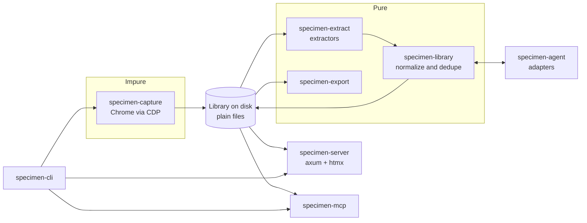

# Specimen: Technical Requirements Document (TRD)

| | |
|---|---|
| **Status** | Draft v0.1 |
| **Date** | 2026-11-25 |
| **Audience** | Contributors and maintainers |
| **Related** | [PRD.md](PRD.md) · [SPEC.md](SPEC.md) · [APP_FLOW.md](APP_FLOW.md) · [AGENT.md](AGENT.md) · [TESTING_GUIDE.md](TESTING_GUIDE.md) · [IMPLEMENTATION-PLAN.md](IMPLEMENTATION-PLAN.md) |

Crate names and versions below are **candidates**. Verify current maintenance status, licenses and API fit during Phase 0 spikes (see IMPLEMENTATION-PLAN.md) before depending on them.

---

## 1. Architectural principles

1. **Capture is the only impure stage.** Only `specimen-capture` touches the browser and network. Everything downstream is a pure function of evidence on disk. This makes extraction testable without a browser and lets improved extractors re-run on old captures.
2. **Evidence in, items out.** Extractors implement `Evidence -> Vec<RawItem>` with no side effects.
3. **Measured values are immutable.** The AI stage can only attach annotations (names, tags, roles, descriptions). Enforced in code, not by convention.
4. **Plain files are the database.** No embedded database is required. Indexes are caches and can be deleted.
5. **Deterministic by construction.** Stable ordering, fixed rounding, content-hash IDs, timestamps only in manifests and provenance.
6. **Fail soft.** One failed extractor or asset must not abort a capture. Collect warnings, continue, report.
7. **Local and private.** No telemetry, no cloud, loopback-only servers.
8. **Boring tech where possible.** Prefer well maintained crates and standard formats.

## 2. System architecture



### 2.1 Workspace layout

```
specimen/
├── Cargo.toml                 # workspace
├── rust-toolchain.toml        # pinned toolchain
├── deny.toml                  # cargo-deny: licenses, bans, advisories
├── crates/
│   ├── specimen-core/         # types, schemas, errors, config, canonical JSON, IDs
│   ├── specimen-capture/      # browser lifecycle, CDP session, page/flow/crawl drivers
│   ├── specimen-extract/      # extractors: palette, typography, icons, effects, ...
│   ├── specimen-library/      # fs layout, writers, normalize, dedupe, search index
│   ├── specimen-agent/        # AgentAdapter trait, adapters, prompt builder, validators
│   ├── specimen-export/       # css, tailwind, dtcg, scss, tokens-studio
│   ├── specimen-server/       # local web app (axum, askama, htmx)
│   ├── specimen-mcp/          # MCP server
│   └── specimen-cli/          # binary `specimen`
├── fixtures/                  # deterministic fixture sites + ground truth
├── schemas/                   # JSON Schemas (generated and checked in)
├── data/                      # icon fingerprint DB, color name tables (generated)
├── xtask/                     # dev automation (schema gen, fingerprint build, release)
├── docs/
└── .github/workflows/
```

### 2.2 Crate dependency rules

```
specimen-core         ← (no internal deps)
specimen-extract      → core
specimen-library      → core
specimen-export       → core, library
specimen-agent        → core
specimen-capture      → core
specimen-server       → core, library, export
specimen-mcp          → core, library, export
specimen-cli          → all
```

`specimen-extract` MUST NOT depend on `specimen-capture`. `cargo-deny` and a CI check enforce the graph.

## 3. Technology choices

| Concern | Choice (candidate) | Why | Alternatives |
|---|---|---|---|
| Language | Rust (current stable edition, MSRV pinned in `rust-toolchain.toml`) | Single static binary, speed, strong typing for data pipelines | Go, TypeScript |
| Async runtime | `tokio` | Standard; needed by CDP and web server | `async-std` |
| CLI | `clap` (derive) + `clap_complete` | Mature | `argh` |
| Browser control | `chromiumoxide` (CDP, async) | Typed CDP bindings, tokio-native | `headless_chrome`; own thin CDP client over WebSocket using generated CDP types |
| CSS parsing | `lightningcss` | Fast, spec-aware, handles modern CSS | `cssparser` + `selectors` directly |
| Color math | `palette` (OKLab/OKLCH) + `csscolorparser` | Perceptual color distance | Hand-written |
| SVG | `usvg` (parse and normalise), `resvg` (render previews) | Robust normalisation to simple paths | `svgtypes` |
| Fonts | `ttf-parser` / `read-fonts` (metadata, outlines); WOFF2 decode crate (verify, spike) | Name table, OS/2, fvar, glyph outlines | `fontations` |
| Images | `image`, `webp-animation` (or similar) for clips | Previews, thumbnails, animated WebP | shell out to `ffmpeg` |
| Serialisation | `serde`, `serde_json`, `toml`, `serde_yaml` (flow files; verify maintenance, or use `yaml-rust2`-based) | Standard | |
| JSON Schema | `schemars` (generate) + `jsonschema` (validate) | Schemas derived from Rust types | |
| Hashing | `sha2`, `blake3` (internal, fast) | Content IDs and asset hashes | |
| HTTP (assets, robots) | `reqwest` (rustls) | Standard | `ureq` |
| robots.txt | `texting_robots` or similar | Spec-correct parsing | hand-rolled |
| Web server | `axum` + `askama` templates + `htmx` (vendored) + `rust-embed` | No JS build step; single binary | SPA with Vite |
| MCP | `rmcp` (official Rust SDK; verify version and API) | Protocol compliance | hand-rolled JSON-RPC |
| Search | In-memory inverted index over `item.json` (v0.2); `tantivy` if libraries exceed ~50k items | Simple first | |
| Parallel CPU work | `rayon` | Extraction is CPU-bound | |
| Errors | `thiserror` in libraries, `anyhow`/`miette` in the binary | Typed errors inside, friendly at the edge | |
| Logging | `tracing` + `tracing-subscriber` | Structured, spans per stage | |
| Testing | `insta`, `proptest`, `assert_cmd`, `predicates`, `tempfile`, `wiremock` or local `axum` fixture server | See TESTING_GUIDE.md | |
| Release | `cargo-dist` + GitHub Actions; Homebrew tap | Cross-platform binaries and installers | manual |
| Supply chain | `cargo-deny`, `cargo-audit` | License and advisory gates | |

### 3.1 Why server-rendered UI instead of a SPA

The web app is read-mostly and needs galleries, filters and previews. Server-rendered HTML with htmx keeps the toolchain Rust-only, removes a Node build from contributor setup, and embeds cleanly in the single binary. Animation and layout previews use small vanilla JS modules. Revisit if interactive editing grows.

## 4. Data model (Rust sketch)

```rust
// specimen-core
pub enum ItemType { Icon, Palette, Typography, Theme, Layout, Effect, Animation, Component }

pub struct Item<D> {
    pub schema: SchemaVersion,        // "specimen.item/1"
    pub id: ItemId,                   // <type>-<slug>-<hash8>
    pub item_type: ItemType,
    pub name: Option<String>,
    pub slug: String,
    pub description: Option<String>,
    pub tags: BTreeSet<String>,
    pub data: D,                      // typed per item type, canonicalised
    pub provenance: Vec<Provenance>,
    pub license: License,
    pub confidence: f32,
    pub similar_to: Vec<ItemId>,
    pub annotations: Option<Annotations>,
    pub user: UserMeta,
    pub previews: Vec<RelPath>,
}

pub struct Annotations { pub by: String, pub at: Timestamp, pub prompt_hash: String }
```

Rules:

- `data` types derive `Serialize + Deserialize + JsonSchema` with `#[serde(deny_unknown_fields)]`.
- `canonical_json(&data)` produces the bytes hashed for IDs: sorted keys, floats rounded to a fixed number of decimals per field, no insignificant whitespace.
- Newtype wrappers for `ItemId`, `SourceId`, `RelPath` (relative, validated: no `..`, no absolute paths) prevent mix-ups and path traversal.

### 4.1 Evidence model

Evidence is versioned (`specimen.evidence/1`) and split into files so large captures stay manageable:

| File | Content |
|---|---|
| `evidence/dom/<viewport>-<scheme>.json` | Flattened DOM snapshot with per-node computed style subset, bounding boxes, text length (text itself optional), attributes (sanitised) |
| `evidence/css/*.css` + `index.json` | Stylesheets as loaded, with URL, media, order |
| `evidence/computed/` | Full computed styles for selected nodes (interactive, headings, samples) |
| `evidence/animations/` | Animation records and sampled traces |
| `evidence/network.json` | Method, URL, status, type, size, MIME, timing. No request or response bodies, no auth headers |
| `assets/`, `assets-restricted/` | Downloaded files by content hash |

DOM snapshots use the CDP `DOMSnapshot.captureSnapshot` API (computed style whitelist, bounding rects, paint order), which avoids thousands of round trips.

## 5. Capture subsystem (`specimen-capture`)

### 5.1 Browser lifecycle

- **Discovery order:** `--browser` flag → `$SPECIMEN_BROWSER` → config → common install paths (Chrome, Chromium, Edge, Brave) → pinned download (`specimen doctor --install-browser`, using Chrome for Testing builds).
- Launch with a fresh temporary profile directory (deleted on exit), `--headless=new` unless `--headed`, a fixed set of stability flags, and remote debugging over a pipe or loopback WebSocket.
- A `BrowserGuard` kills the process tree on drop, on SIGINT and on panic. Crashes trigger one automatic restart per page, then a recorded failure.
- Tested browser major versions are pinned in CI and recorded in each `manifest.json`.

### 5.2 Page drivers

`PageDriver` trait with three implementations: `SinglePage`, `Flow`, `Crawl`. They share a `Session` that exposes:

```rust
pub trait Session {
    async fn navigate(&mut self, url: &Url) -> Result<NavOutcome>;
    async fn settle(&mut self, policy: &SettlePolicy) -> Result<()>;
    async fn emulate(&mut self, vp: &Viewport, scheme: Scheme) -> Result<()>;
    async fn snapshot(&mut self) -> Result<DomSnapshot>;
    async fn screenshot(&mut self, opts: ShotOpts) -> Result<Image>;
    async fn force_pseudo(&mut self, node: NodeId, states: &[Pseudo]) -> Result<()>;
    async fn animations(&mut self) -> Result<Vec<AnimationRecord>>;
    async fn sample_frames(&mut self, spec: &SampleSpec) -> Result<Trace>;
    async fn network_log(&self) -> NetworkLog;
}
```

### 5.3 CDP domains used

| Need | Domain and method |
|---|---|
| Navigation, lifecycle, screenshots, screencast | `Page` (`navigate`, `captureScreenshot`, `startScreencast`, lifecycle events) |
| DOM and styles at scale | `DOMSnapshot.captureSnapshot` |
| Style rules, used fonts, forced states | `CSS` (`getMatchedStylesForNode`, `getPlatformFontsForNode`, `forcePseudoState`, stylesheet events) |
| Fonts and assets | `Network` (`responseReceived`, `getResponseBody`, request interception off by default) |
| Media features | `Emulation` (`setEmulatedMedia`, `setDeviceMetricsOverride`) |
| Animations | `Animation` (`enable`, `animationStarted`, `getPlaybackRate`, `setPlaybackRate`, `seekAnimations`) |
| Scripts | `Runtime.evaluate` (read-only helper scripts; see 5.5) |
| Shadow DOM and iframes | `DOM` with `pierce`, `Target` auto-attach for out-of-process iframes |
| Input | `Input.dispatchMouseEvent`, `dispatchKeyEvent` |

### 5.4 Settle, scroll and lazy content

1. Wait for `Page.lifecycleEvent` `load`, then network quiet (750 ms) and no layout shift (500 ms), under a hard timeout.
2. Scroll in steps (default 400 px, 150 ms pause), recording scroll positions at which animations start (scroll-into-view triggers). Scroll back to top.
3. Re-run settle. Take snapshots and screenshots.

Cookie and consent banners are **recorded as part of the page**, not auto-dismissed. An optional `--dismiss-overlays` best-effort heuristic can be added later; it MUST NOT click anything labelled as accepting data sharing without user opt-in.

### 5.5 Injected helper scripts

Small, audited JS helpers (embedded as strings, no remote code) run via `Runtime.evaluate` or `Page.addScriptToEvaluateOnNewDocument`:

- `observe-animations.js`: wraps `Element.prototype.animate`, listens to `animationstart` and `transitionstart`, records targets and timing.
- `frame-sampler.js`: on request, samples computed `transform`, `opacity` and a configured property list for listed elements each `requestAnimationFrame` for N ms.
- `detect-libs.js`: detects globals and markers for GSAP, Framer Motion, Lottie, Anime.js, three.js, and similar.
- `scroll-observer.js`: records `IntersectionObserver` driven class or style changes.

Helpers are read-only observers. They MUST NOT submit forms, navigate, or alter page state beyond the scroll and hover actions the capture driver itself performs.

### 5.6 Network policy

- Honour `robots.txt` by default (fetched and cached per origin for the run).
- Token-bucket rate limit per host (default 1 request/s for crawl navigation; subresource loads by the page are not throttled but are bounded by page timeouts).
- User agent: the browser's genuine UA with ` Specimen/<version>` appended (configurable).
- **Blocked by default:** non-HTTP(S) schemes, private and link-local address ranges (including after DNS resolution, to prevent rebinding), unless `--allow-private`.
- No proxy rotation, no fingerprint evasion, no CAPTCHA handling. Block pages are detected (status codes, known interstitial markers) and reported as `E-BLOCKED`.

### 5.7 Authenticated captures

`--headed` opens a visible browser with a temporary profile. The user signs in manually and signals ready in the terminal. Specimen then captures. On exit the temporary profile is deleted. Cookies, localStorage, sessionStorage and auth headers are never written to disk by Specimen. `--redact-text` strips node text from snapshots before they are written.

## 6. Extraction subsystem (`specimen-extract`)

```rust
pub trait Extractor: Send + Sync {
    fn kind(&self) -> ItemType;
    fn version(&self) -> u32;                         // bump on logic change
    fn extract(&self, ev: &Evidence, cfg: &ExtractCfg) -> Result<Vec<RawItem>, ExtractError>;
}
```

- Extractors are registered in a table; `rayon` runs independent extractors in parallel.
- Each `RawItem` carries `data`, provenance, confidence, license suggestion and optional preview request (rendering is a separate step).
- Extractor versions are written to `manifest.json`. `specimen normalize` can detect that a newer extractor exists and offer to re-extract old sources.
- Heuristics (color roles, component clusters, section detection) live in their own modules with documented thresholds and unit tests built from fixtures.

### 6.1 Notable algorithms

**Color roles.** Compute effective background for each text node by walking ancestors and compositing alpha, weight by rendered area, then rank. `background` = largest area behind body text; `surface` = elevated container colors differing from background; `accent` = colors on elements with interactive roles or underlined links, filtered by chroma. All role assignments carry confidence below 1.

**Icon normalisation.** Parse with `usvg`, flatten transforms, convert shapes to path data, snap coordinates to a fixed grid, order subpaths canonically, hash. Fingerprint matching compares the hash first, then a tolerance-based comparison on normalised path commands.

**Icon fonts.** Detect fonts whose used code points fall in private-use ranges or whose family is in a known list; extract glyph outlines for code points that appear in `::before` and `::after` content and in text nodes; convert outlines to SVG paths.

**Component clustering.** Build a signature vector per element (display, box metrics class, padding, radius, fill, border, typography, child tag sequence), cluster by exact signature then merge near clusters by distance; label by role heuristics.

**Layout skeletons.** Compute a reduced tree retaining only nodes with layout significance (landmark, flex or grid container, repeated children, sized media), collapse single-child wrappers, replace text with `{text:N}` placeholders, and map to an SVG wireframe.

**Spacing scale.** Collect px values, compute a histogram, estimate a base unit by maximising the share of values that are multiples of candidate units (2, 4, 6, 8), report the observed scale and outliers.

## 7. Library subsystem (`specimen-library`)

- **Writer:** atomic writes (write to temp file in the same directory, `fsync`, rename). A capture is written to a `.partial` folder and renamed on completion, so interrupted runs leave no corrupt sources.
- **Locking:** an advisory lock file (`.cache/lock`) prevents concurrent writers; readers do not lock.
- **Normalize:** reads sources → raw items → canonicalise → compute IDs → merge into collections (extend provenance for identical IDs, link near duplicates).
- **Near-duplicate detection:** colors by OKLab distance; icons by raster similarity of fixed-size renders; effects by numeric tolerance on their parameters.
- **Index:** at startup (for `search`, `serve`, `mcp`) build an in-memory index from `item.json` files, cached in `.cache/index.bin` keyed by file mtimes and sizes.
- **Asset policy:** assets with `license.status = reusable` go to `assets/`; others to `assets-restricted/` (listed in the generated `.gitignore`).
- **Path safety:** every path read from JSON is validated as relative and resolved inside the library root.

## 8. Motion capture strategy (hardest part)

| Layer | Method | Reliability |
|---|---|---|
| 1. Static CSS | Parse stylesheets for `@keyframes`, `animation*`, `transition*`, `animation-timeline` | High |
| 2. Runtime CSS/WAAPI | `Animation` domain events plus `document.getAnimations()` yield resolved keyframes and timing for animations that actually ran | High |
| 3. Trigger probing | Hover, focus and click on interactive elements and scroll steps; diff animation sets before and after to attach a trigger to each animation | Medium |
| 4. Sampled traces | For elements whose visual properties change without a CSS or WAAPI animation (JS libraries), sample computed styles per frame during load, scroll and probing; fit easing curves to samples (cubic-bezier regression) | Medium to low |
| 5. Library detection | Fingerprint globals and bundled markers; record `driver` and, for Lottie, save the JSON | Medium |
| 6. Recording | `Page.startScreencast` frames encoded to a preview clip | High (visual only) |

Determinism: when possible, slow or pause animations with `Animation.setPlaybackRate` / `seekAnimations` to sample at exact times. Virtual time controls are experimental in CDP, so they are a spike item with a wall-clock fallback and a tolerance.

Known gaps: canvas, WebGL and video are recorded as clips only; physics-based spring animations are reported as sampled traces with an approximate spring fit when detectable.

## 9. AI agent subsystem (`specimen-agent`)

See AGENT.md Part B for the contract. Summary of technical requirements:

```rust
#[async_trait::async_trait]
pub trait AgentAdapter: Send + Sync {
    fn id(&self) -> &'static str;
    async fn detect(&self) -> Detection;                        // installed, version, usable
    async fn run(&self, task: &AgentTask, cx: &RunContext) -> Result<AgentOutput, AgentError>;
}
```

- Adapters spawn the agent CLI as a child process in a **scratch directory** that contains only the task files (evidence slice as JSON, screenshot paths, output schema). The working directory is never the user's library root.
- Output is requested as JSON conforming to a schema and parsed strictly. Anything else is an error.
- `merge_annotations()` is the only code path that applies agent output, and it only writes annotation fields. A validator rejects outputs that reference unknown IDs or introduce numeric or color values not present in the input.
- Hard timeouts and output size limits; process tree killed on timeout.
- A **manual mode** writes task files to `.cache/tasks/` and prints instructions so a user can run any agent by hand and feed results back with `specimen interpret --import <file>`.

## 10. Exporters, server and MCP

**Exporters** (`specimen-export`) are pure functions from selected items to text files, with golden tests per format.

**Server** (`specimen-server`):

- Binds to `127.0.0.1` only; refuses non-loopback `Host` headers (defence against DNS rebinding); sets strict `Content-Security-Policy`; no external requests from pages.
- Serves previews and assets from the library through a path-validated handler.
- Rendering uses Askama templates; htmx is vendored.

**MCP** (`specimen-mcp`):

- Read-only tools by default. `capture_url` is off unless enabled in config.
- If enabled, capture requests pass through the same URL policy as the CLI (private ranges blocked, robots respected, rate limits).
- Tool outputs are size-bounded and contain no filesystem paths outside the library.

## 11. Security and privacy

| Threat | Control |
|---|---|
| **Prompt injection** from captured pages into the agent | Page-derived text is data only: passed through files, truncated, never concatenated into instruction text; agent runs in a scratch directory; read-only or tool-less mode used when the CLI supports it; output validated against schema and restricted to annotations; nothing from agent output is executed |
| **Secrets in evidence** | Redact `Authorization`, `Cookie`, `Set-Cookie` and configured headers; do not store bodies except for font/asset downloads; strip tokens from URLs in stored logs (query values for known sensitive keys); `--redact-text` |
| **Malicious assets** (SVG scripts, oversized files) | Sanitise SVG (remove script, event handlers, external references); size caps; never execute downloaded content; render previews with `resvg` (no scripting) |
| **Path traversal** | Newtype `RelPath` validation; canonicalise and check prefix before any file read or write |
| **SSRF through MCP or server** | Capture disabled by default over MCP; private range blocking; loopback-only bind |
| **Zip or decompression bombs** (WOFF2, archives in v2) | Output size limits during decoding |
| **Supply chain** | `cargo-deny`, `cargo-audit` in CI; `Cargo.lock` committed; pinned CI actions; minimal dependency policy; reproducible release builds |
| **Browser sandbox** | Use Chrome sandbox (do not pass `--no-sandbox` by default; document containers where it is unavoidable and warn) |
| **Legal exposure** | License status, restricted assets directory, notices (PRD §9) |

## 12. Performance targets

| Metric | Target |
|---|---|
| Single page capture (4 viewports × 2 schemes, typical marketing page) | under 60 s on broadband |
| Extraction after capture (same page) | under 3 s |
| Normalize 1,000 items | under 2 s |
| Search over 10,000 items | under 100 ms warm |
| Peak memory (excluding browser) | under 500 MB for typical pages |
| Binary size (no browser, release, stripped) | under 40 MB |

Measured with `criterion` benchmarks for extraction and normalisation, and with fixture captures timed in CI as a regression signal (not a hard gate on shared runners).

## 13. Observability and diagnostics

- `tracing` spans per stage (`capture.page`, `extract.palette`, `agent.run`, ...) with durations in `manifest.json`.
- `--log-level` and `--log-json`. Default logs omit page text and full URLs with query strings.
- `specimen doctor` prints versions of Specimen, browser, agent CLIs, OS, and library schema.
- `report.md` lists warnings, skipped extractors and capture limits per source.

## 14. Platform and packaging

- Targets: `x86_64`/`aarch64` for macOS, Linux (glibc and musl where feasible), Windows.
- Build features: `web` (embeds UI) and `mcp` are on by default; a `--no-default-features` build gives a CLI-only binary.
- Releases through `cargo-dist`: archives, installers, checksums, Homebrew tap, `cargo install specimen-cli`.
- Path handling uses `camino` or `std::path` with explicit normalisation for Windows; no reliance on case-sensitive file names.

## 15. Coding standards (summary; full rules in AGENT.md)

- `#![forbid(unsafe_code)]` in all crates unless a documented exception is approved.
- No `unwrap()` or `expect()` outside tests and provably infallible cases (comment required).
- `clippy` with `-D warnings`; `rustfmt` enforced.
- Public types documented; JSON Schemas regenerated and diffed in CI.
- Conventional Commits; PRs require tests and doc updates.

## 16. Architecture decision records (initial)

| ID | Decision | Rationale | Revisit when |
|---|---|---|---|
| ADR-001 | Rust, single binary | Distribution simplicity, performance | Never expected |
| ADR-002 | Plain files, no embedded DB | Git-friendly, inspectable, diffable | Libraries beyond ~100k items |
| ADR-003 | Capture/extract separation | Testability, re-run on old evidence | Never expected |
| ADR-004 | AI is annotation-only | Prevents invented values; reproducibility | A verified safe use case emerges |
| ADR-005 | Server-rendered UI with htmx | Rust-only toolchain | Rich editing is required |
| ADR-006 | CDP via `chromiumoxide` behind an internal trait | Swap or replace without touching extractors | Crate becomes unmaintained |
| ADR-007 | Content-hash IDs | Free de-duplication, stable links | Schema redesign |
| ADR-008 | `assets-restricted/` gitignored | Prevents publishing proprietary files | Legal review suggests changes |
| ADR-009 | Loopback-only servers with Host check | Local security baseline | Remote/team mode is added |
| ADR-010 | No evasion of bot protection | Ethical and legal posture | Never |

## 17. Technical risks and spikes

| Risk | Spike (Phase 0) | Success criterion |
|---|---|---|
| CDP animation capture is incomplete | Capture CSS, WAAPI and GSAP fixtures using `Animation` domain and samplers | ≥ 95% of fixture animations recovered with correct timing |
| Agent CLIs cannot run non-interactively with schema output | Script each target agent CLI against a toy task | Valid JSON output in ≥ 9/10 runs per agent, or documented manual-mode fallback |
| WOFF2 decoding and name-table parsing in Rust | Parse 20 real fonts | All parse; metadata matches reference tooling |
| `chromiumoxide` coverage of needed CDP calls | Implement snapshot, forced states, screencast | All calls work on pinned Chrome |
| Icon-font glyph to SVG conversion | Convert glyphs from 3 common icon fonts | Visual match to browser rendering |
| Windows browser lifecycle | Launch, capture and kill on Windows CI | No orphan processes |

## 18. Future technical directions

- **APK capture (v2):** crate `specimen-apk` that decodes resources (own parser or wrapping `apktool`), converts VectorDrawable to SVG, parses animation XML, and optionally drives an emulator through `adb` for screenshots and UI hierarchy dumps. Output reuses the same item types and library layout.
- **Team library mode:** git-based sharing is v1; a read-only static site export (`specimen publish-site`) could follow, restricted to `reusable` items.
- **Plugin API:** third-party extractors as WASM modules.
- **Visual similarity search** using perceptual hashes.
